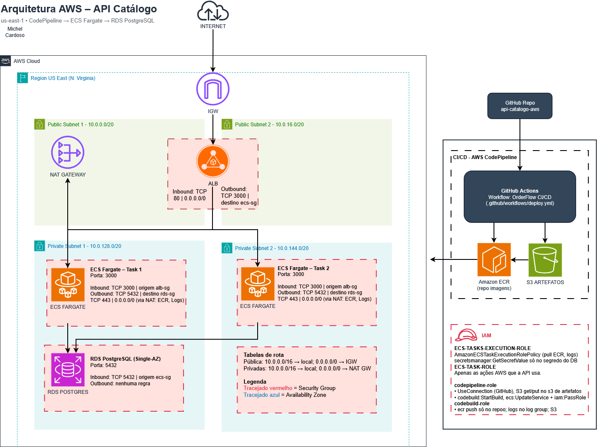
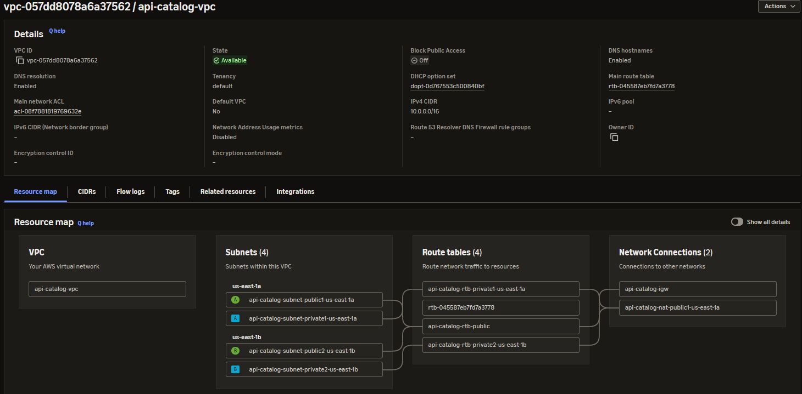
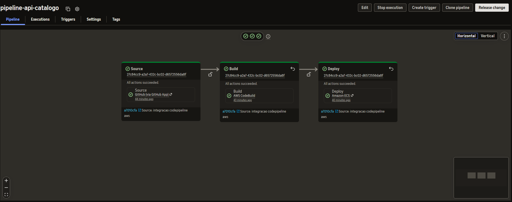
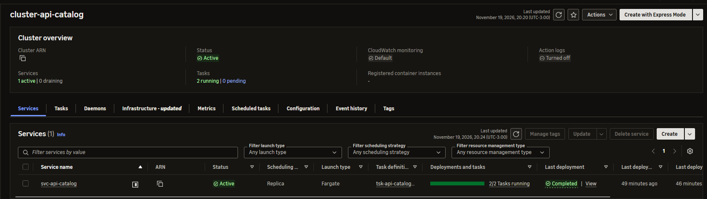
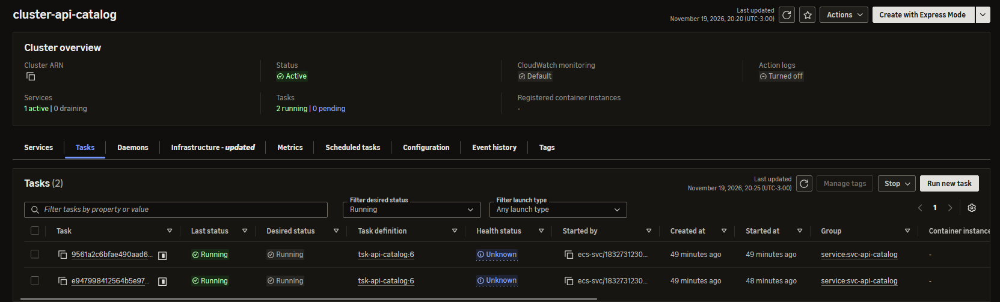

# 🛒 API Catálogo

## 📖 Sobre o projeto

API REST para cadastro e consulta de produtos, desenvolvida em **Node.js + PostgreSQL**, conteinerizada com **Docker** e implantada na **AWS** com **ECS Fargate**, **RDS**, **ECR** e um pipeline de **CI/CD com CodePipeline + CodeBuild**.

O foco do projeto é a **infraestrutura em nuvem**: rede própria (VPC com subnets públicas e privadas), banco em subnet privada, segredos fora do código, Security Groups encadeados e IAM com **privilégio mínimo**.


---

## 📖 Visão geral

| Item | Detalhe |
|---|---|
| **Aplicação** | API REST de catálogo de produtos (CRUD + busca por nome) |
| **Runtime** | Node.js 20 (ES Modules) com Express |
| **Banco de dados** | PostgreSQL 16 (local) / Amazon RDS PostgreSQL (AWS) |
| **Acesso ao banco** | Knex.js (query builder) com migrations e seeds |
| **Validação** | Zod (body, params e query) |
| **Container** | Docker, imagem baseada em `node:20-alpine` |
| **Orquestração** | Amazon ECS com Fargate (2 tasks em 2 Availability Zones) |
| **CI/CD** | GitHub → CodePipeline → CodeBuild → ECS |
| **Região** | `us-east-1` (N. Virginia) |

---

## 🏗 Arquitetura



O diagrama em draw.io (com CIDRs, Security Groups, IAM e rotas) está em [`docs/images/arq-api-catalogo-aws.drawio`](docs/images/arq-api-catalogo-aws.drawio) e pode ser aberto em [app.diagrams.net](https://app.diagrams.net).

### Fluxo de uma requisição

1. O cliente envia a requisição HTTP para o **Application Load Balancer** (subnets públicas, porta 80).
2. O ALB encaminha para o **Target Group** `tg-api-catalog`, que distribui entre as tasks Fargate (porta 3000) nas subnets privadas.
3. A task consulta o **RDS PostgreSQL** (porta 5432), que só aceita conexões vindas do Security Group das tasks.
4. A saída das tasks para a internet (ECR, CloudWatch Logs) passa pelo **NAT Gateway**.

---

## 🛠 Tecnologias

**Aplicação**
- Node.js 20, Express 4
- Knex.js + driver `pg`
- Zod (validação de entrada)
- dotenv

**Containerização**
- Docker (imagem `node:20-alpine`, `npm ci --omit=dev`)
- Docker Compose (ambiente local com a API + PostgreSQL 16)

**AWS**
- **VPC** com subnets públicas/privadas, Internet Gateway e NAT Gateway
- **Application Load Balancer** + Target Group
- **ECS Fargate** (cluster, task definition e service)
- **ECR** (registro das imagens Docker)
- **RDS PostgreSQL** (Single-AZ, em subnet privada)
- **Secrets Manager** (credenciais do banco)
- **CodePipeline** + **CodeBuild** (CI/CD)
- **IAM** e **Security Groups** com privilégio mínimo
- **CloudWatch Logs** (logs dos containers)

**Ferramentas**
- Postman (testes dos endpoints)
- Git / GitHub

---

## 🌐 Rede (VPC)

VPC dedicada `api-catalog-vpc` (`10.0.0.0/16`) distribuída em **2 Availability Zones**:

| Subnet | AZ | CIDR | Uso |
|---|---|---|---|
| `api-catalog-subnet-public1` | us-east-1a | `10.0.0.0/20` | ALB, NAT Gateway |
| `api-catalog-subnet-public2` | us-east-1b | `10.0.16.0/20` | ALB |
| `api-catalog-subnet-private1` | us-east-1a | `10.0.128.0/20` | Tasks ECS, RDS |
| `api-catalog-subnet-private2` | us-east-1b | `10.0.144.0/20` | Tasks ECS, RDS (DB Subnet Group) |

**Tabelas de rota**

| Tabela | Rotas |
|---|---|
| Pública (`api-catalog-rtb-public`) | `10.0.0.0/16 → local`, `0.0.0.0/0 → Internet Gateway` |
| Privadas (`rtb-private1` e `rtb-private2`) | `10.0.0.0/16 → local`, `0.0.0.0/0 → NAT Gateway` |

O **DB Subnet Group** do RDS usa apenas as subnets privadas, e o banco **não tem acesso público**.



---

## 🔐 Segurança: Security Groups e IAM

### Security Groups (referenciando outros SGs, sem abrir CIDRs desnecessários)

| Security Group | Inbound | Outbound |
|---|---|---|
| `alb-sg` | TCP 80 ← `0.0.0.0/0` | TCP 3000 → `ecs-sg` |
| `ecs-sg` | TCP 3000 ← `alb-sg` | TCP 5432 → `rds-sg` · TCP 443 → `0.0.0.0/0` (ECR, Logs via NAT) |
| `rds-sg` | TCP 5432 ← `ecs-sg` | Nenhuma regra |

- Sem SSH aberto em nenhum recurso.
- O banco só é alcançável a partir das tasks da API.

### IAM (privilégio mínimo)

| Role | Permissões principais |
|---|---|
| `ecs-task-execution-role` | `AmazonECSTaskExecutionRolePolicy` (pull do ECR e logs) + `secretsmanager:GetSecretValue` restrito ao segredo do banco |
| `ecs-task-role` | Somente as ações AWS que a aplicação usa, sem `*` |
| `codepipeline-role` | `UseConnection` (GitHub), S3 get/put no bucket de artefatos, `codebuild:StartBuild`, `ecs:UpdateService` e `iam:PassRole` das roles da task |
| `codebuild-role` | Push no repositório ECR específico, escrita no log group e acesso ao S3 de artefatos |

### Segredos

As credenciais do banco **não ficam no código nem na imagem**: são armazenadas no **AWS Secrets Manager** e injetadas na task pelo ECS. Localmente, os arquivos `api.env` e `db.env` ficam fora do Git (`.gitignore`) e fora da imagem (`.dockerignore`).

---

## 🔄 CI/CD

Pipeline `pipeline-api-catalogo`, disparado a cada push no repositório:

```text
┌──────────┐      ┌───────────────┐      ┌───────────────┐
│  Source  │ ───▶ │     Build     │ ───▶ │    Deploy     │
│  GitHub  │      │   CodeBuild   │      │   Amazon ECS  │
│ (GitHub  │      │ docker build  │      │ rolling update│
│   App)   │      │ + push no ECR │      │ do service    │
└──────────┘      └───────────────┘      └───────────────┘
```

1. **Source** — GitHub via GitHub App.
2. **Build** — CodeBuild executa o [`buildspec.yml`](buildspec.yml): login no ECR, `docker build`, `docker push` e geração do `imagedefinitions.json`.
3. **Deploy** — a ação do ECS lê o `imagedefinitions.json` e faz o *rolling update* do service Fargate.

**Versionamento das imagens:** cada imagem é tagueada com o **SHA do commit** (`$CODEBUILD_RESOLVED_SOURCE_VERSION`), o que garante rastreabilidade entre o código e o que está rodando, além de facilitar rollback para uma versão anterior.

**Variáveis do projeto CodeBuild:** `AWS_ACCOUNT_ID`, `AWS_DEFAULT_REGION`, `IMAGE_REPO_NAME`, `CONTAINER_NAME`.



---

## ☁️ Execução no ECS Fargate

| Recurso | Nome |
|---|---|
| Cluster | `cluster-api-catalog` |
| Service | `svc-api-catalog` (estratégia Replica, launch type Fargate) |
| Task Definition | `tsk-api-catalog` |
| Tasks em execução | 2 (uma por Availability Zone) |
| Load Balancer | `alb-api-catalog` (listener HTTP:80 → `tg-api-catalog`) |

Ao iniciar, o container aguarda o banco ficar disponível, executa as **migrations** (`knex migrate:latest`) e inicia a API. A rota `GET /health` está disponível para verificação de saúde.





---

## 📡 Endpoints da API

Base path: `/api/products`

| Método | Rota | Descrição | Resposta |
|---|---|---|---|
| `GET` | `/health` | Verificação de saúde | `200` |
| `GET` | `/api/products` | Lista produtos (filtro opcional `?q=` por nome) | `200` `{ items, total }` |
| `POST` | `/api/products` | Cria um produto | `201` |
| `GET` | `/api/products/:id` | Busca produto por ID (UUID) | `200` / `404` |
| `PUT` | `/api/products/:id` | Atualiza campos do produto | `200` / `404` |
| `DELETE` | `/api/products/:id` | Remove o produto | `204` / `404` |

### Modelo do produto

| Campo | Tipo | Regras |
|---|---|---|
| `id` | UUID | Gerado pelo banco (`gen_random_uuid()`) |
| `name` | string | 2 a 150 caracteres, **único** |
| `description` | text | Opcional |
| `price` | decimal(12,2) | Obrigatório, positivo |
| `created_at` / `updated_at` | timestamp | Preenchidos automaticamente |

### Exemplos

```bash
# Criar produto
curl -X POST http://<ALB_DNS>/api/products \
  -H "Content-Type: application/json" \
  -d '{"name": "Camiseta Básica", "description": "100% algodão", "price": 59.90}'

# Listar / buscar por nome
curl "http://<ALB_DNS>/api/products?q=camiseta"

# Atualizar
curl -X PUT http://<ALB_DNS>/api/products/<id> \
  -H "Content-Type: application/json" \
  -d '{"price": 49.90}'

# Remover
curl -X DELETE http://<ALB_DNS>/api/products/<id>
```

Erros de validação retornam `400` com os detalhes do Zod; rotas inexistentes retornam `404`.

---

## 💻 Executando localmente

**Pré-requisitos:** Docker e Docker Compose.

```bash
# 1. Clonar o repositório
git clone https://github.com/myxenje/api-catalogo.git
cd api-catalogo

# 2. Criar os arquivos de ambiente a partir dos exemplos
cp api.env.example api.env
cp db.env.example db.env
# edite os valores (usuário, senha e nome do banco)

# 3. Subir API + PostgreSQL
docker compose up --build
```

A API ficará disponível em `http://localhost:3000`.

### Variáveis de ambiente

**`api.env`**

| Variável | Descrição |
|---|---|
| `NODE_ENV` | `development` roda o seed de produtos de exemplo; qualquer outro valor pula o seed |
| `PORT` | Porta da API (padrão `3000`) |
| `PG_HOST` | `db` no Compose / endpoint do RDS na AWS |
| `PG_PORT` | Porta do PostgreSQL (padrão `5432`) |
| `PG_USER`, `PG_PASSWORD`, `PG_DATABASE` | Credenciais e nome do banco |
| `PG_SSL` | `false` localmente, `true` no RDS |

**`db.env`**: `POSTGRES_USER`, `POSTGRES_PASSWORD`, `POSTGRES_DB`.

### Migrations e seeds

```bash
npm run migrate    # aplica as migrations
npm run rollback   # desfaz a última migration
npm run seed       # popula produtos de exemplo (somente NODE_ENV=development)
```

---

## 📂 Estrutura do projeto

```text
api-catalogo/
├── docker/
│   └── entrypoint.sh          # aguarda o DB, roda migrations/seed e inicia a API
├── docs/                      # diagrama e evidências (prints da AWS)
├── migrations/                # criação da extensão pgcrypto e da tabela products
├── seeds/                     # dados de exemplo (apenas em desenvolvimento)
├── src/
│   ├── controllers/           # camada HTTP
│   ├── services/              # regras de negócio
│   ├── repositories/          # acesso ao banco (Knex)
│   ├── routes/                # definição das rotas
│   ├── schemas/               # validações Zod
│   ├── middlewares/           # validação e tratamento de erros
│   ├── db/knex.js             # instância do Knex
│   ├── app.js
│   └── server.js
├── buildspec.yml              # build e push da imagem (CodeBuild)
├── docker-compose.yaml        # ambiente local
├── Dockerfile
├── knexfile.js                # configuração do banco (pool, SSL, timeouts)
└── package.json
```

A aplicação segue uma arquitetura em camadas: **routes → controllers → services → repositories**.

---

## 👨‍💻 Autor

Michel Cardoso

Projeto desenvolvido para fins de estudo e prática de tecnologias voltadas para desenvolvimento BackEnd, infraestrutura, aws cloud e containerização.